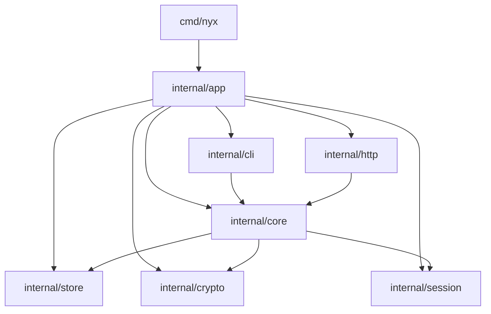

# Nyx Program Architecture

- [Purpose](#purpose)
- [Architecture Goals](#architecture-goals)
- [Proposed Package Layout](#proposed-package-layout)
- [Package Responsibilities](#package-responsibilities)
- [Dependency Rules](#dependency-rules)
- [Composition Root](#composition-root)
- [Security-Critical Package Boundaries](#security-critical-package-boundaries)
- [References](#references)

## Purpose

This document defines the Go package architecture for Nyx, with emphasis on package boundaries and dependency relationships.

## Architecture Goals

- One shared core logic for both CLI and HTTP.
- Clear dependency direction with minimal package layering.
- Security-sensitive code isolated and easy to review.
- Local-file persistence with atomic update semantics.
- Easy testing with small, focused package boundaries.

## Proposed Package Layout

- cmd/nyx: thin program entrypoint.
- internal/app: mode-specific builders and runtime wiring.
- internal/core: shared business logic and rules used by both CLI and HTTP.
- internal/store: local repository file persistence and atomic update handling.
- internal/crypto: password-based key derivation and encryption/decryption operations.
- internal/session: local unlock session management.
- internal/cli: CLI commands and output mapping.
- internal/http: HTTP handlers and response mapping.
- doc: project specifications and references.

Note: only top-level packages are shown here; subpackages are intentionally omitted.

## Package Responsibilities

### internal/app

Responsibilities:

- Provide mode-specific builders (CLI mode and HTTP mode).
- Wire core with concrete store, crypto, and session dependencies.
- Return runnable components for cmd/nyx to launch.

### internal/core

Responsibilities:

- Implement repository and secret lifecycle behaviors from [doc/core_api.md](core_api.md).
- Enforce business and security rules (for example immutable fields and masking behavior).
- Define operation-level error semantics for adapters.

### internal/store

Responsibilities:

- Load/save/delete repository files.
- Enforce atomic write behavior and file permission expectations.
- Handle repository-name to file-location mapping.

### internal/crypto

Responsibilities:

- Implement cryptographic operations defined by [doc/repository_format.md](repository_format.md).
- Handle Argon2id key derivation and AEAD encryption/decryption.
- Never expose sensitive key material through logs or user-facing errors.

### internal/session

Responsibilities:

- Create, validate, and revoke local unlock sessions.
- Enforce session expiration rules.

### internal/cli

Responsibilities:

- Parse CLI input and options.
- Call internal/core operations.
- Map core errors to CLI output and exit codes.

### internal/http

Responsibilities:

- Parse HTTP requests and authenticate session tokens.
- Call internal/core operations.
- Map core errors to HTTP status and JSON error responses.

## Dependency Rules

Allowed imports:

- cmd/nyx -> internal/app
- internal/app -> internal/core, internal/store, internal/crypto, internal/session, internal/cli, internal/http
- internal/cli -> internal/core
- internal/http -> internal/core
- internal/core -> internal/store, internal/crypto, internal/session
- internal/store -> no dependencies on internal/cli or internal/http
- internal/crypto -> no dependencies on internal/cli or internal/http
- internal/session -> no dependencies on internal/cli or internal/http

Forbidden imports:

- cmd/nyx -> internal/core, internal/store, internal/crypto, internal/session, internal/cli, internal/http
- internal/core -> internal/app
- internal/core -> internal/cli
- internal/core -> internal/http
- internal/store -> internal/app
- internal/store -> internal/core
- internal/crypto -> internal/app
- internal/crypto -> internal/core
- internal/session -> internal/app
- internal/session -> internal/core

## Composition Root

The composition root is in internal/app. cmd/nyx remains a thin launcher.

Responsibilities:

- Build concrete infrastructure implementations.
- Construct core service with store, crypto, and session dependencies.
- Build CLI mode runner and HTTP mode runner.
- Provide common config (data dir, session TTL, bind address).

## Security-Critical Package Boundaries

Security-critical code should be concentrated in:

- internal/crypto
- internal/store
- internal/core

Guidelines:

- Avoid logging secret plaintext, master passwords, DEK/KEK, or raw ciphertext internals.
- Keep crypto decisions in one place, not scattered across adapters.
- Keep repository-format read/write logic centralized.

## References

- [doc/core_api.md](core_api.md)
- [doc/repository_format.md](repository_format.md)
- [doc/session_management.md](session_management.md)
- [doc/cli.md](cli.md)
- [doc/http.md](http.md)
